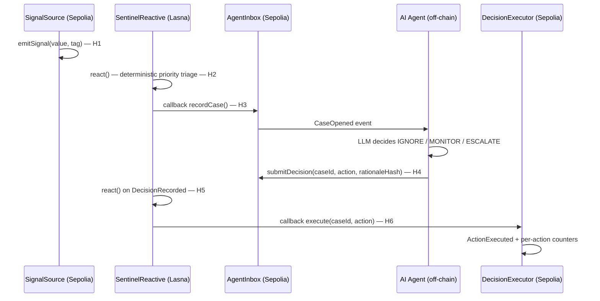

# Sentinel Agent

**Reactive Omni Buildathon — track: Reactive Meets AI**

A stream of signals lands on Ethereum Sepolia. Nobody should need a human
watching a dashboard at 3 a.m. Sentinel Agent triages each signal
autonomously: a reactive contract catches it the second it is emitted, files
it as a case on Sepolia, an AI agent reads the case and decides the response,
and a second reactive hop executes that decision on-chain — every step
provable with explorer links, no keeper, no cron, no human in the loop.

> Track rule, in the organizers' words: for Reactive Meets AI, "the AI has
> to be part of the running system, not just the tool you used to write the
> code." In Sentinel Agent the model sits **inside** the loop: it interprets
> each case the reactive contract files and decides what the reactive system
> does next. Its prompt, raw outputs, rationale hashes and decision
> transactions are all part of the evidence below.

## Architecture



Two design rules keep the AI honest:

- The on-chain triage in `SentinelReactive` only computes **priority**
  (HIGH when `value >= 500`). It never decides the response.
- The **decision** belongs to the model. If the agent service is offline,
  cases queue visibly in `AgentInbox` — nothing is silently dropped.

## Contracts

| Contract | Chain | Address |
|---|---|---|
| SignalSource | Ethereum Sepolia (11155111) | `0x3c62C3aa7881b8b571e6569B210849C404Ef6d8E` |
| SentinelReactive | Reactive Lasna (5318007) | `0x529A93Be2d526c686ecb0D5A6FB32fEea6382B3E` |
| AgentInbox | Ethereum Sepolia (11155111) | `0x7b9155f7B50559ea2Bb730C0939B59A522bF069E` |
| DecisionExecutor | Ethereum Sepolia (11155111) | `0x6e7f241817707dE3B85E470606e2028EC88eF2E4` |

Explorers: https://sepolia.etherscan.io · https://lasna.reactscan.net

Fixed network facts: Lasna RPC `https://lasna-rpc.rnk.dev/` (chain-id
verified by `cast`; the `-omni` hostname from the May-2025 launch post no
longer responds), system contract `0x8888…8888`, Sepolia callback proxy
`0xAa14d9Cd0f788Ca23d11805986C1d8bd035D23b4`.

### Subscriptions (recorded — they live in the Reactive node, not in storage)

| Subscriber | Origin chain | Contract | topic0 |
|---|---|---|---|
| SentinelReactive | Sepolia 11155111 | SignalSource | `Signal(address,uint256,uint256)` |
| SentinelReactive | Sepolia 11155111 | AgentInbox | `DecisionRecorded(uint256,uint8)` |

All other topics are `REACTIVE_IGNORE`. Both subscriptions show **Active**
on the SentinelReactive page in Reactscan.

## Proof — the full loop, twice (2026-11-23)

### Scenario A — critical signal `(950, tag 7)` → model decides **ESCALATE**

| Step | Hash |
|---|---|
| H1 origin event | `0xe90ef7b9f6f38cc368700825979a708f6a7fe9bebd1e818f811b9d87ef443384` |
| H2 reactive tx | `0xf78fd06c847cfbd9c09fb8c0dbd8aff6d510ef4c4e20a1072e8827539ad9591a` |
| H3 callback (CaseOpened) | `0x50e8c7ff98ac28280ec7a227eaf50905742337083c490331b23ebdef25e57e46` |
| H4 model decision tx | `0x10c25f1bb23cbe5f654a85a282df822e3030d05328fce52ac6b95fb7e1c93de5` |
| H5 reactive tx (hop 2) | `0x662ce245f050d50074c9919ccff0ca6ec2a39df90c4602d8e248a67c81dc7948` |
| H6 callback (ActionExecuted) | `0x5105370feb1c62e30f92db51862d79458f13ba2ebec4ad030308a0cd8e9a6bd1` |

Model rationale (hash committed on-chain in H4): *"Value 950 with tag 7
matches the critical-infrastructure pattern and was flagged HIGH priority
on-chain; escalate for immediate action."*

### Scenario B — routine signal `(120, tag 3)` → model decides **MONITOR**

| Step | Hash |
|---|---|
| H1 origin event | `0xc30cb4d0cc6e33b2f2dec89fefc79f54c5a1b51043fee088c7222c9d23f33cea` |
| H2 reactive tx | `0xdf88344924db9684caa1baf904db1eac73c874decc34c1f673dc62e7f0c33a67` |
| H3 callback (CaseOpened) | `0x1d476678c7992ddaa23f03eba901984ab1bbc7434265ec88ff485c5c780d53e5` |
| H4 model decision tx | `0x36789ff0f868269d1e4ad57f3755e730c11e1d34fb49c8e935493399e9fd7179` |
| H5 reactive tx (hop 2) | `0x0ad51db0138af530692b9134f57ff1ce7998d467f044c2bab2a2994afd4bdbd5` |
| H6 callback (ActionExecuted) | `0x7e5bfbbfee3d5f1b692075242ba425906ae555e77c99791e5d7d2b067cd65e8e` |

Model rationale: *"Value 120 with tag 3 is routine telemetry at NORMAL
priority; no intervention warranted, keep the stream under watch."*
On-chain `rationaleHash` for case 2 was verified to equal
`keccak256(rationale)` — the model's words are provably the ones submitted.

An earlier single-hop run (M1, pre-dates the current contract set) is
recorded in `deployments/m1-hashes.md`.

## Security / hardening (verified on-chain, M3)

Negative tests — all revert as designed:

| Attempt | Result |
|---|---|
| `recordCase` called directly (not via proxy) | `NotAuthorized` |
| `execute` called directly (not via proxy) | `NotAuthorized` |
| `react()` called by a non-system address | `NotAuthorized` |
| `submitDecision` from a non-agent EOA | `NotAgent` |
| Second decision on an already-decided case | `AlreadyDecided` |

Callback payloads always reserve the first argument as `address(0)` (the
network overwrites it with the reactive contract's address); callback gas
limit is 1,000,000. `react()` never reverts on non-matching logs.

Run `script/health-check.sh` before any demo: it prints `debt()` and
reserves for every contract. Rule: never start a run with debt > 0.

## Run it yourself

Prereqs: Foundry (`forge`/`cast`), Python 3 for the agent service.

```bash
cp .env.example .env            # fill RPC URLs + keys (testnet only!)
forge build
bash script/deploy-m2.sh        # deploys the M2 set, writes deployments/m2-addresses.env
bash script/health-check.sh     # all debts must be 0

# terminal 1 — the AI agent service
DECIDER=gemini GEMINI_API_KEY=... python3 agent/agent.py
# (or DECIDER=operator for a supervised run: the service writes
#  agent/requests/case-<id>.json and waits for your model's decision in
#  agent/decisions/case-<id>.json)

# terminal 2 — fire a signal
cast send $SIGNAL_SOURCE "emitSignal(uint256,uint256)" 950 7 \
  --rpc-url $SEPOLIA_RPC_URL --private-key $DEPLOYER_PRIVATE_KEY
# then watch the loop land: case in AgentInbox, decision, ActionExecuted.
```

Funding (testnet only): Sepolia ETH from any public faucet; lREACT by
sending Sepolia ETH to the faucet contract
`0x9b9BB25f1A81078C544C829c5EB7822d747Cf434` via `request(address)`
(1 ETH → 100 lREACT; never send more than 5 ETH in one transaction).

## Layout

- `src/` — SignalSource, SentinelReactive, AgentInbox, DecisionExecutor
- `agent/` — the off-chain AI agent service + its decision log (`log.jsonl`)
- `script/` — deploy + health-check scripts
- `deployments/` — addresses and hash evidence per milestone

Built entirely during the buildathon on Lasna + Sepolia testnets.
License: MIT (contracts), see repository.
